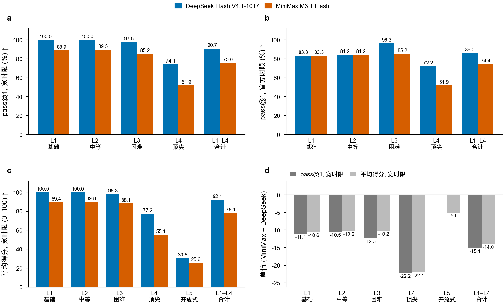
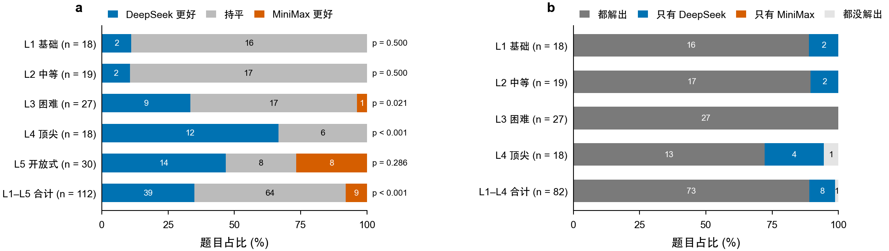
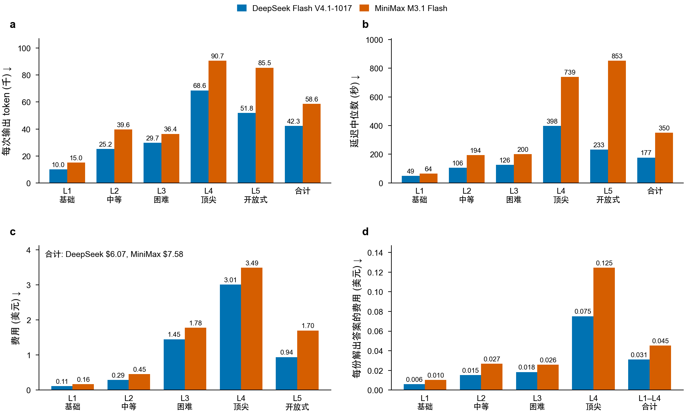
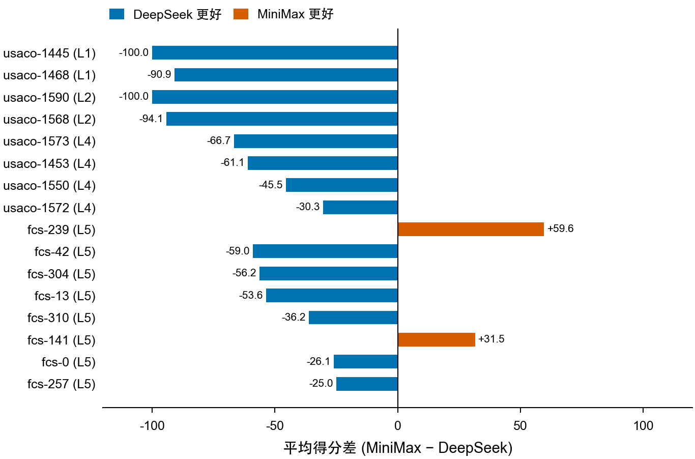

# 阶梯代码评测报告：DeepSeek Flash V4.1-1017 / MiniMax M3.1 Flash

2026-10-29　L1–L4：USACO 2024–26 与 EGOI/IOI 2026；L5：FrontierCS 算法赛道

- DeepSeek Flash V4.1-1017：2 道题在运行后从题单中剔除（当前判题程序无法正确评测），其答案不计入：egoi26-census、egoi26-seatingplan。
- MiniMax M3.1 Flash：13 个采样单次生成超过 20 分钟被切断，再以 30 分钟为限重问一次：3 个在时限内完成，按正常答案判题；10 个仍未完成（其中 6 个是服务端在约 24–30 分钟时主动断开），记为“生成超时”。超时请求的输出 token 为按字数估算的值。

## 模型简介

各模型的发布信息、相较上一版的更新与亮点，整理自厂商公告与模型卡；标注“厂商自报”的分数未经独立复现，与本报告的测评结果不是同一口径。

### DeepSeek Flash V4.1-1017

| 项目 | 内容 |
|---|---|
| 厂商 | DeepSeek |
| 发布 | V4.1-Flash 2026-09-10 发布；2026-10-17 更新为 1017 版（API 名 deepseek-flash 与价格不变） |
| 权重与许可 | 开放权重，MIT 许可 |
| 架构 | 多模态 MoE：主干 552B 参数，每 token 激活 8B（prefill）/ 16B（decode），另有 196B Engram 条件记忆；上下文 1M；支持图像输入 |
| 价格 | 每百万 token 输入 $0.30、缓存命中 $0.006、输出 $1.20；北京时间非高峰时段半价 |
| 本次调用 | DeepSeek 官方 API |

相较上一版的更新：

- 1017 版相较 9 月版：官方称缩短了任务耗时和输出长度；厂商自报 Terminal-Bench 4.0 31.2 → 42.3、DeepSWE v1.1 74.2 → 77.0、ProgramBench 20.3 → 29.1、NL2Repo-Bench 65.4 → 68.2、HLE（无工具）36.8 → 42.6
- V4.1 代相较 V4-Flash：新架构系列里最小的模型，原生支持视觉理解；持久 KV cache 约为 V4-Flash 的 1/8，全局 KV cache 每 token 890 字节、约为 1/4；Codeforces 评分 3289 → 3471（厂商自报，各次测评环境不完全相同）

亮点：

- 开放权重、MIT 许可，单价在同档里偏低，非高峰再打对折
- 1M 上下文，思考深度可调（API 提供 low / high / max）
- 厂商自报 DeepSWE v1.1 77.0、Terminal-Bench 4.0 42.3，偏重智能体编程

资料来源：[DeepSeek API 更新日志](https://api-docs.deepseek.com/updates/)；[DeepSeek-V4.1-Flash 模型卡](https://huggingface.co/deepseek-ai/DeepSeek-V4.1-Flash)

### MiniMax M3.1 Flash

| 项目 | 内容 |
|---|---|
| 厂商 | MiniMax |
| 发布 | 2026-09-27 以 M3.1-Flash-Preview 在 MiniMax Code 内测；2026-10-19 正式上线 API；2026-10-23 放出权重 |
| 权重与许可 | 开放权重，MiniMax Community License（商用须标注；年收入 2000 万美元以上须书面授权） |
| 架构 | MoE：总参数约 428B、每 token 激活约 23B（与 M3 同规模），官方称采用更激进的稀疏化；上下文 1M；输入文本、图像、视频；思考不能关闭，深度用 reasoning_effort 调（默认 max） |
| 价格 | 每百万 token 输入 $0.15、缓存 $0.015、输出 $0.60，不分时段、不分上下文长度（国内站 ¥1 / ¥0.1 / ¥4） |
| 本次调用 | MiniMax 官方 API（国内站，OpenAI 兼容接口）；生成分两个账户完成（Token Plan 套餐额度与按量计费），模型与参数相同 |

相较上一版的更新：

- 官方称在线推理速度快了近 3 倍，智能体任务的整体使用成本比前代低 70%（博客未点名前代）；输出速度可达 200+ token/s，P50 在 170+
- 2026-10-19 起 MiniMax 把 M2.5、M2.7 归为旧版，套餐内对它们的请求自动改由 M3.1 Flash 处理

亮点：

- 定位智能体任务：长程软件工程、电脑操作、企业流程自动化、网络安全
- 厂商自报 DeepSWE v1.1 73.7%、OSWorld V2 61.7、Agents' Last Exam 29.6、CyberGym 82%
- 单价是同档最低的一批；第三方测评提示其幻觉率偏高，答案需要核验

资料来源：[MiniMax 官方博客：M3.1 Flash](https://www.minimax.io/blog/minimax-m31f)；[MiniMax 接口文档](https://platform.minimax.io/docs/guides/text-generation)；[权重与许可（OrcaRouter 汇总）](https://www.orcarouter.ai/blog/minimax-m3-1-flash-open-weights)；[VentureBeat：幻觉率](https://venturebeat.com/technology/minimaxs-new-m3-1-flash-beats-deepseek-and-opus-5-on-a-key-business-benchmark-at-lower-cost-but-with-a-high-hallucination-rate)

## 评测维度与打分标准

各维度分开报告，不合成总分；表格中 ↑ 越大越好，↓ 越小越好，没有箭头的只作描述。

| 维度 | 指标 | 计算方法 | 方向 |
|---|---|---|---|
| 正确性 | 测试点得分 s_t | 每个测试点 0–1：USACO 忽略空白逐 token 比对，相同为 1、否则 0；EGOI、IOI 取官方 checker 给出的 0–1 分；FrontierCS 取官方 checker 输出的 Ratio（达到参考解为 0.6，超过参考解按对数加分，最高 1）。程序编译失败、运行出错、超时或超内存，该测试点为 0。 |  |
| 正确性 | 题目得分 S（0–100） | USACO：S = 100 \cdot \frac{1}{T}\sum_t s_t（每个测试点等分）；EGOI、IOI：S = 100 \cdot \frac{\sum_g w_g \min_{t \in g} s_t}{\sum_g w_g}（子任务 g 取其中测试点的最低分，再乘以子任务分值 w_g）；FrontierCS：S = 100 \cdot \frac{1}{T}\sum_t \mathrm{Ratio}_t。 | ↑ |
| 正确性 | 解出 | 所有测试点 s_t = 1。 |  |
| 正确性 | pass@1、平均得分、pass@n | pass@1 = 解出的采样数 ÷ 采样总数 × 100；平均得分 = 所有采样的 S 的平均；pass@n = 至少一次采样解出的题数 ÷ 题数 × 100。每档采样次数：L1、L2、L5 各 1 次，L3、L4 各 3 次，temperature 0.2。 | ↑ |
| 正确性 / 效率 | 宽时限与官方时限 | 每个测试点只运行一次，时限为官方时限的 5 倍（宽时限）。宽时限口径：按上面的规则计分。官方时限口径：CPU 时间超过官方时限的测试点记 0，再按同样的规则算 S、pass@1。前者回答“算法对不对”，后者回答“是否和人类选手一样在时限内通过”。 | ↑ |
| 效率 | 运行时间倍数 | 只对解出的答案、且官方解在某个测试点上至少需要 0.05 秒 CPU 的题：取官方解最慢的 3 个测试点，答案与官方解交替各运行 3 次取中位数，r = 答案 CPU 时间 ÷ 官方解 CPU 时间（取官方解最慢的那个测试点）；各档报告 r 的几何平均和题数。同语言比较。 | ↓ |
| 效率 | 内存倍数 | 解出的答案在所有测试点上的峰值内存 ÷ 官方解的峰值内存，各档取几何平均。 | ↓ |
| 复杂度 | 相对官方解的增长幂次 k | 官方测试不是按规模排列的序列（USACO 里耗时较长的测试点大多都是最大规模），所以以官方解自己的工作量为横轴：在官方解至少需要 2 ms CPU（扣除空程序）的测试点上（最多 20 个，均匀覆盖其耗时范围），答案与官方解交替各运行 5 次取中位数，拟合 \log y_{答案} = a + k \log y_{官方}。若官方解为 \Theta(f(n))、答案为 \Theta(f(n)^k)，k 即该指数。R^2 \ge 0.8 时：k \le 0.75 且在官方解最重的 3 个测试点上答案至少快 2 倍为更优（列出供人工复核），0.75 < k < 1.33 为同阶，k \ge 1.33 且在这些测试点上至少慢 2 倍为更差；R^2 < 0.8，或斜率与最重测试点上的快慢对不上（某一方有固定开销会把斜率拉偏），为不确定；可用测试点少于 4 个或官方耗时跨度不足 4 倍为不可测。空间同理（峰值内存，至少高于空程序 1 MB）。这些测试点的输入大小跨度达到 8 倍时，另报两者按输入大小的增长幂次。 |  |
| 失败类型 | 每份未解出答案的主要原因 | 按顺序取第一个成立的：无代码、编译错误、答案错误、运行错误、超内存、超时、部分分（部分测试点得分）；宽时限下解出但官方时限下没有全部通过的记为“只在官方时限下超时”。单次生成超过时间上限的请求被切断，记为“生成超时”（视为没有通过；上限与重问见报告开头的说明）。FrontierCS 为连续分，得分大于 0 的答案记为部分分，只有 0 分的答案按上面的顺序找原因。 |  |
| 静态质量 | Pylint、Radon、SonarQube（只限 L1–L2 的 Python 答案） | 按 arXiv:2610.19167 的口径与版本：Pylint 3.3.5 默认配置的问题数（C/R/W/E）与 0–10 分，Radon 6.0.1 的圈复杂度（所有条目之和）、可维护性指数 MI、SLOC，SonarQube 10.4 的可维护性/可靠性/安全问题数；报告正确答案的每份平均与每百行 SLOC 的问题数。 | 见表头 |
| 成本与时延 | token、费用、延迟、首个 token 时间 | 费用 = (输入 − 缓存命中) × 输入单价 + 缓存命中 × 命中单价 + 输出（含思考）× 输出单价，单价按每百万 token，分时计价按每次调用的开始时间；延迟为每次调用从发出到收完的时间。 | ↓ |
| 泄露检查 | 2026 子集与 USACO 子集 | L3、L4 中 EGOI/IOI 2026 新题与同档 USACO 旧题分开报告 pass@1 与平均得分；新题明显更差时提示旧题可能见过。只作提示，不作结论。 |  |

## 两个模型对比

DeepSeek = DeepSeek Flash V4.1-1017，MiniMax = MiniMax M3.1 Flash；“差”一律为 MiniMax − DeepSeek（百分点或分），正数表示 MiniMax 更高。

L1–L4 合计 pass@1（宽时限）DeepSeek 90.7%、MiniMax 75.6%（-15.1）；L5 平均得分 DeepSeek 30.6、MiniMax 25.6（-5.0）。逐题按平均得分比较（112 题）：DeepSeek 更好 39 题，MiniMax 更好 9 题，持平 64 题，符号检验 p < 0.001（p < 0.05 才说明差距不太可能只是采样的随机波动）。费用 DeepSeek $6.07、MiniMax $7.58（MiniMax 是 DeepSeek 的 1.25 倍）；每次调用平均输出 token DeepSeek 42.3k、MiniMax 58.6k（1.38 倍）。

### 成绩

各档成绩。a–c 每档两根柱分别为 DeepSeek、MiniMax，柱上为数值；d 为两者之差（MiniMax − DeepSeek）。L5 为连续分，没有 pass@1。

### 逐题胜负

只比较两个模型都有结果的题。每题取所有采样的平均得分，相差不到 0.05 分记为持平；“解出”指至少一次采样解出（L5 为连续分，不适用）。符号检验只看胜负题数、不看差距大小。

逐题胜负。a 按每题平均得分，柱右为符号检验 p 值；b 按是否解出（至少一次，L1–L4）。柱长为占该档题数的比例，柱内数字为题数，n 为题数。

### 成本与速度

每份解出答案的费用 = 该档费用 ÷ 宽时限下解出的采样数；合计只算 L1–L4（L5 没有“解出”）。费用按各自的标价计算，包括超时被切断的调用。

成本与速度。a 每次调用的平均输出 token（含思考）；b 每次调用的延迟中位数；c 各档费用；d 每份解出答案的费用。均为越低越好。

### 结果不同的题

L1–L4 中一个模型至少解出一次、另一个一次都没解出的题，以及 L5 中平均得分相差 20 分以上的题；按差距从大到小。

结果不同的题的平均得分之差（MiniMax − DeepSeek），向左为 DeepSeek 更好，向右为 MiniMax 更好。

| 题目 | 名称 | 档位 | 解出 / 采样 DeepSeek | 解出 / 采样 MiniMax | 平均得分 DeepSeek ↑ | 平均得分 MiniMax ↑ | 平均得分 差 ↑ | 落后一方的主要失败 |
|---|---|---|---:|---:|---:|---:|---:|---|
| usaco-1445 | It's Mooin' Time | L1 | 1/1 | 0/1 | 100.0 | 0.0 | -100.0 | 运行错误 |
| usaco-1468 | It's Mooin' Time II | L1 | 1/1 | 0/1 | 100.0 | 9.1 | -90.9 | 答案错误 |
| usaco-1590 | Clash! | L2 | 1/1 | 0/1 | 100.0 | 0.0 | -100.0 | 答案错误 |
| usaco-1568 | Farmer John Loves Rotations | L2 | 1/1 | 0/1 | 100.0 | 5.9 | -94.1 | 答案错误 |
| usaco-1573 | Cow Circle | L4 | 2/3 | 0/3 | 66.7 | 0.0 | -66.7 | 生成超时 |
| usaco-1453 | It's Mooin' Time | L4 | 2/3 | 0/3 | 66.7 | 5.6 | -61.1 | 编译错误 |
| usaco-1550 | Pluses and Minuses | L4 | 1/3 | 0/3 | 45.5 | 0.0 | -45.5 | 生成超时 |
| usaco-1572 | Circle of Cows | L4 | 1/3 | 0/3 | 48.5 | 18.2 | -30.3 | 答案错误 |
| fcs-239 | FrontierCS #239 | L5 | – | – | 0.0 | 59.6 | +59.6 | 答案错误 |
| fcs-42 | FrontierCS #42 | L5 | – | – | 59.0 | 0.0 | -59.0 | 编译错误 |
| fcs-304 | FrontierCS #304 | L5 | – | – | 56.2 | 0.0 | -56.2 | 编译错误 |
| fcs-13 | FrontierCS #13 | L5 | – | – | 53.6 | 0.0 | -53.6 | 生成超时 |
| fcs-310 | FrontierCS #310 | L5 | – | – | 62.2 | 26.1 | -36.2 | 部分分 |
| fcs-141 | FrontierCS #141 | L5 | – | – | 7.9 | 39.5 | +31.5 | 部分分 |
| fcs-0 | FrontierCS #0 | L5 | – | – | 60.2 | 34.1 | -26.1 | 部分分 |
| fcs-257 | FrontierCS #257 | L5 | – | – | 47.9 | 23.0 | -25.0 | 部分分 |

## 各档正确率

| 档位 | 模型 | 题数 | 采样数 | pass@1 宽时限 ↑ | pass@1 官方时限 ↑ | 平均得分 宽时限 ↑ | 平均得分 官方时限 ↑ | pass@n ↑ |
|---|---|---:|---:|---:|---:|---:|---:|---:|
| L1 基础 | DeepSeek Flash V4.1-1017 | 18 | 18 | 100.0 | 83.3 | 100.0 | 94.7 | – |
| L1 基础 | MiniMax M3.1 Flash | 18 | 18 | 88.9 | 83.3 | 89.4 | 88.5 | – |
| L2 中等 | DeepSeek Flash V4.1-1017 | 19 | 19 | 100.0 | 84.2 | 100.0 | 95.2 | – |
| L2 中等 | MiniMax M3.1 Flash | 19 | 19 | 89.5 | 84.2 | 89.8 | 87.0 | – |
| L3 困难 | DeepSeek Flash V4.1-1017 | 27 | 81 | 97.5 | 96.3 | 98.3 | 98.3 | 100.0 |
| L3 困难 | MiniMax M3.1 Flash | 27 | 81 | 85.2 | 85.2 | 88.1 | 88.1 | 100.0 |
| L4 顶尖 | DeepSeek Flash V4.1-1017 | 18 | 54 | 74.1 | 72.2 | 77.2 | 76.6 | 94.4 |
| L4 顶尖 | MiniMax M3.1 Flash | 18 | 54 | 51.9 | 51.9 | 55.1 | 55.1 | 72.2 |
| L5 开放式 | DeepSeek Flash V4.1-1017 | 30 | 30 | 不适用 | 不适用 | 30.6 | 28.6 | – |
| L5 开放式 | MiniMax M3.1 Flash | 30 | 30 | 不适用 | 不适用 | 25.6 | 24.5 | – |

宽时限 = 官方时限的 5 倍，看算法对不对；官方时限看能否像人类选手一样在时限内通过。pass@n = 每题多次采样中至少解出一次的题目比例（L3 每题 3 次、L4 每题 3 次）；每题只采样 1 次的档记“–”。L5 按 0–100 连续计分（达到官方参考解约 60 分，超过越多分越高），没有“解出”一说，pass@1 记为“不适用”，只看平均得分。

## 2026 新题与 USACO 旧题对照

同一档内 2026 年新题与 USACO 旧题分开统计（宽时限）。难度相当而新题明显更差时，旧题成绩可能受训练数据泄露抬高；只作提示，不作结论。

| 档位 | 子集 | 模型 | 题数 | 采样数 | pass@1 ↑ | 平均得分 ↑ |
|---|---|---|---:|---:|---:|---:|
| L3 困难 | 2026 新题（EGOI / IOI） | DeepSeek Flash V4.1-1017 | 6 | 18 | 100.0 | 100.0 |
| L3 困难 | 2026 新题（EGOI / IOI） | MiniMax M3.1 Flash | 6 | 18 | 83.3 | 84.4 |
| L3 困难 | USACO 2024-25 | DeepSeek Flash V4.1-1017 | 12 | 36 | 97.2 | 98.8 |
| L3 困难 | USACO 2024-25 | MiniMax M3.1 Flash | 12 | 36 | 86.1 | 89.2 |
| L3 困难 | USACO 2025-26 | DeepSeek Flash V4.1-1017 | 9 | 27 | 96.3 | 96.6 |
| L3 困难 | USACO 2025-26 | MiniMax M3.1 Flash | 9 | 27 | 85.2 | 89.1 |
| L4 顶尖 | USACO 2024-25 | DeepSeek Flash V4.1-1017 | 11 | 33 | 75.8 | 78.4 |
| L4 顶尖 | USACO 2024-25 | MiniMax M3.1 Flash | 11 | 33 | 63.6 | 64.7 |
| L4 顶尖 | USACO 2025-26 | DeepSeek Flash V4.1-1017 | 7 | 21 | 71.4 | 75.3 |
| L4 顶尖 | USACO 2025-26 | MiniMax M3.1 Flash | 7 | 21 | 33.3 | 40.2 |

## 代码性能（相对官方解，同语言）

只比较解出的答案：在官方解最慢的 3 个测试点上与官方解交替各运行 3 次取中位数，倍数 = 答案 ÷ 官方解，各档取几何平均；小于 1 表示比官方解快。EGOI、FrontierCS 没有官方解，不参与。

| 档位 | 模型 | 比较的答案数 | CPU 时间倍数 ↓ | 快于官方解（份） | 慢 2 倍以上（份） | 峰值内存倍数 ↓ |
|---|---|---:|---:|---:|---:|---:|
| L1 基础 | DeepSeek Flash V4.1-1017 | 12 | 0.66× | 10 | 2 | 0.98× |
| L1 基础 | MiniMax M3.1 Flash | 10 | 0.42× | 9 | 1 | 0.80× |
| L2 中等 | DeepSeek Flash V4.1-1017 | 9 | 0.84× | 7 | 0 | 1.32× |
| L2 中等 | MiniMax M3.1 Flash | 8 | 0.54× | 8 | 0 | 1.14× |
| L3 困难 | DeepSeek Flash V4.1-1017 | 58 | 0.58× | 47 | 3 | 0.92× |
| L3 困难 | MiniMax M3.1 Flash | 51 | 0.45× | 43 | 0 | 0.83× |
| L4 顶尖 | DeepSeek Flash V4.1-1017 | 37 | 0.96× | 18 | 9 | 1.25× |
| L4 顶尖 | MiniMax M3.1 Flash | 25 | 0.55× | 21 | 2 | 0.99× |

## 时间与空间复杂度（相对官方解）

k 为答案耗时（或峰值内存）相对官方解的增长幂次：k ≤ 0.75 且在官方解最重的测试点上至少快 2 倍为更优（可能是更好或更新颖的解法），0.75 < k < 1.33 为同阶，k ≥ 1.33 且至少慢 2 倍为更差，其余为不确定；方法见“评测维度与打分标准”。

### 时间复杂度

| 档位 | 模型 | 更优 | 同阶 | 更差 | 不确定 | 不可测 | 无官方解 | k 中位数 |
|---|---|---:|---:|---:|---:|---:|---:|---:|
| L1 基础 | DeepSeek Flash V4.1-1017 | 1 | 4 | 0 | 3 | 4 | 6 | 0.91 |
| L1 基础 | MiniMax M3.1 Flash | 3 | 3 | 0 | 3 | 1 | 6 | 0.79 |
| L2 中等 | DeepSeek Flash V4.1-1017 | 0 | 6 | 0 | 0 | 3 | 10 | 1.01 |
| L2 中等 | MiniMax M3.1 Flash | 0 | 6 | 0 | 0 | 2 | 9 | 0.99 |
| L3 困难 | DeepSeek Flash V4.1-1017 | 4 | 42 | 2 | 10 | 3 | 18 | 0.97 |
| L3 困难 | MiniMax M3.1 Flash | 11 | 35 | 0 | 8 | 0 | 15 | 0.95 |
| L4 顶尖 | DeepSeek Flash V4.1-1017 | 4 | 28 | 0 | 1 | 4 | 3 | 0.95 |
| L4 顶尖 | MiniMax M3.1 Flash | 3 | 19 | 1 | 0 | 2 | 3 | 0.93 |

### 空间复杂度

| 档位 | 模型 | 更优 | 同阶 | 更差 | 不确定 | 不可测 | 无官方解 | k 中位数 |
|---|---|---:|---:|---:|---:|---:|---:|---:|
| L1 基础 | DeepSeek Flash V4.1-1017 | 0 | 1 | 0 | 1 | 10 | 6 | 0.83 |
| L1 基础 | MiniMax M3.1 Flash | 0 | 0 | 0 | 1 | 9 | 6 | – |
| L2 中等 | DeepSeek Flash V4.1-1017 | 0 | 4 | 0 | 0 | 5 | 10 | 0.94 |
| L2 中等 | MiniMax M3.1 Flash | 0 | 3 | 0 | 0 | 5 | 9 | 0.89 |
| L3 困难 | DeepSeek Flash V4.1-1017 | 0 | 2 | 0 | 6 | 53 | 18 | 1.18 |
| L3 困难 | MiniMax M3.1 Flash | 0 | 1 | 0 | 4 | 49 | 15 | 1.13 |
| L4 顶尖 | DeepSeek Flash V4.1-1017 | 0 | 1 | 1 | 5 | 30 | 3 | 1.40 |
| L4 顶尖 | MiniMax M3.1 Flash | 0 | 0 | 1 | 3 | 21 | 3 | 1.38 |

### 增长慢于官方解、值得人工复核的答案

| 档位 | 模型 | 答案 | 维度 |
|---|---|---|---|
| L1 基础 | DeepSeek Flash V4.1-1017 | usaco-1444#0 | 时间 |
| L3 困难 | DeepSeek Flash V4.1-1017 | usaco-1547#0 | 时间 |
| L3 困难 | DeepSeek Flash V4.1-1017 | usaco-1547#2 | 时间 |
| L3 困难 | DeepSeek Flash V4.1-1017 | usaco-1569#1 | 时间 |
| L3 困难 | DeepSeek Flash V4.1-1017 | usaco-1569#2 | 时间 |
| L4 顶尖 | DeepSeek Flash V4.1-1017 | usaco-1502#0 | 时间 |
| L4 顶尖 | DeepSeek Flash V4.1-1017 | usaco-1502#2 | 时间 |
| L4 顶尖 | DeepSeek Flash V4.1-1017 | usaco-1596#0 | 时间 |
| L4 顶尖 | DeepSeek Flash V4.1-1017 | usaco-1596#1 | 时间 |
| L1 基础 | MiniMax M3.1 Flash | usaco-1443#0 | 时间 |
| L1 基础 | MiniMax M3.1 Flash | usaco-1444#0 | 时间 |
| L1 基础 | MiniMax M3.1 Flash | usaco-1517#0 | 时间 |
| L3 困难 | MiniMax M3.1 Flash | usaco-1473#2 | 时间 |
| L3 困难 | MiniMax M3.1 Flash | usaco-1497#0 | 时间 |
| L3 困难 | MiniMax M3.1 Flash | usaco-1497#2 | 时间 |
| L3 困难 | MiniMax M3.1 Flash | usaco-1498#0 | 时间 |
| L3 困难 | MiniMax M3.1 Flash | usaco-1498#2 | 时间 |
| L3 困难 | MiniMax M3.1 Flash | usaco-1522#0 | 时间 |
| L3 困难 | MiniMax M3.1 Flash | usaco-1522#2 | 时间 |
| L3 困难 | MiniMax M3.1 Flash | usaco-1547#1 | 时间 |
| L3 困难 | MiniMax M3.1 Flash | usaco-1569#1 | 时间 |
| L3 困难 | MiniMax M3.1 Flash | usaco-1569#2 | 时间 |
| L3 困难 | MiniMax M3.1 Flash | usaco-1594#2 | 时间 |
| L4 顶尖 | MiniMax M3.1 Flash | usaco-1526#2 | 时间 |
| L4 顶尖 | MiniMax M3.1 Flash | usaco-1549#2 | 时间 |
| L4 顶尖 | MiniMax M3.1 Flash | usaco-1596#2 | 时间 |

## 失败类型（答案数）

每份答案只记一个主要原因（判定顺序见“评测维度与打分标准”）。“只在官方时限下超时”的答案在宽时限下是解出的，单列。L5 是连续分，拿到分的答案都记为“部分分”，这一档主要看得 0 分的原因。

| 档位 | 模型 | 答案数 | 未解出 | 无代码 | 生成超时 | 编译错误 | 答案错误 | 部分分 | 运行错误 | 超时 | 只在官方时限下超时 |
|---|---|---:|---:|---:|---:|---:|---:|---:|---:|---:|---:|
| L1 基础 | DeepSeek Flash V4.1-1017 | 18 | 0 | 0 | 0 | 0 | 0 | 0 | 0 | 0 | 3 |
| L1 基础 | MiniMax M3.1 Flash | 18 | 2 | 0 | 0 | 0 | 1 | 0 | 1 | 0 | 1 |
| L2 中等 | DeepSeek Flash V4.1-1017 | 19 | 0 | 0 | 0 | 0 | 0 | 0 | 0 | 0 | 3 |
| L2 中等 | MiniMax M3.1 Flash | 19 | 2 | 0 | 0 | 0 | 2 | 0 | 0 | 0 | 1 |
| L3 困难 | DeepSeek Flash V4.1-1017 | 81 | 2 | 0 | 0 | 0 | 2 | 0 | 0 | 0 | 1 |
| L3 困难 | MiniMax M3.1 Flash | 81 | 12 | 0 | 0 | 3 | 9 | 0 | 0 | 0 | 0 |
| L4 顶尖 | DeepSeek Flash V4.1-1017 | 54 | 14 | 1 | 0 | 0 | 12 | 0 | 1 | 0 | 1 |
| L4 顶尖 | MiniMax M3.1 Flash | 54 | 26 | 2 | 7 | 6 | 11 | 0 | 0 | 0 | 0 |
| L5 开放式 | DeepSeek Flash V4.1-1017 | 30 | 30 | 2 | 0 | 1 | 4 | 23 | 0 | 0 | 0 |
| L5 开放式 | MiniMax M3.1 Flash | 30 | 30 | 0 | 1 | 7 | 3 | 17 | 0 | 2 | 0 |

## 静态质量（L1–L2，Python）

只统计解出的 Python 答案（L1、L2），每份答案的平均值；工具与版本按 arXiv:2610.19167。

| 档位 | 模型 | 答案数 | Pylint 问题数 ↓ | Pylint 得分 ↑ | Pylint 每百行问题数 ↓ | Radon 圈复杂度 ↓ | Radon 可维护性 MI ↑ | Radon SLOC |
|---|---|---:|---:|---:|---:|---:|---:|---:|
| L1 基础 | DeepSeek Flash V4.1-1017 | 18 | 6.56 | 8.58 | 14.62 | 12.28 | 55.6 | 44.8 |
| L1 基础 | MiniMax M3.1 Flash | 16 | 4.25 | 8.92 | 9.67 | 11.56 | 65.3 | 43.9 |
| L2 中等 | DeepSeek Flash V4.1-1017 | 19 | 10.79 | 8.79 | 12.23 | 25.42 | 46.9 | 88.2 |
| L2 中等 | MiniMax M3.1 Flash | 17 | 5.65 | 9.05 | 8.78 | 17.59 | 59.8 | 64.3 |
| 合计 | DeepSeek Flash V4.1-1017 | 37 | 8.73 | 8.68 | 13.01 | 19.03 | 51.2 | 67.1 |
| 合计 | MiniMax M3.1 Flash | 33 | 4.97 | 8.98 | 9.13 | 14.67 | 62.4 | 54.4 |

SonarQube 需要 Docker，这次评测的机器上没有，未测。

## 用量与费用

调用数只计拿到回答或超时的调用；输出 token 含思考过程；延迟为一次调用从发出到收完的时间；费用按每次调用开始时的分时单价计算。超过时间上限被切断的请求，服务端不返回用量，其输出 token 按已输出的字数估算（每 token 约 3.57 字符）。

| 档位 | 模型 | 调用数 | 输出 token ↓ | 每次输出 token ↓ | 延迟中位数 ↓ | 费用 ↓ |
|---|---|---:|---:|---:|---:|---:|
| L1 基础 | DeepSeek Flash V4.1-1017 | 18 | 180.2k | 10.0k | 49 s | $0.11 |
| L1 基础 | MiniMax M3.1 Flash | 18 | 270.5k | 15.0k | 64 s | $0.16 |
| L2 中等 | DeepSeek Flash V4.1-1017 | 19 | 478.5k | 25.2k | 106 s | $0.29 |
| L2 中等 | MiniMax M3.1 Flash | 19 | 752.0k | 39.6k | 194 s | $0.45 |
| L3 困难 | DeepSeek Flash V4.1-1017 | 81 | 2.41M | 29.7k | 126 s | $1.45 |
| L3 困难 | MiniMax M3.1 Flash | 81 | 2.95M | 36.4k | 200 s | $1.78 |
| L4 顶尖 | DeepSeek Flash V4.1-1017 | 54 | 3.71M | 68.6k | 398 s | $3.01 |
| L4 顶尖 | MiniMax M3.1 Flash | 64 | 5.81M | 90.7k | 739 s | $3.49 |
| L5 开放式 | DeepSeek Flash V4.1-1017 | 30 | 1.55M | 51.8k | 233 s | $0.94 |
| L5 开放式 | MiniMax M3.1 Flash | 33 | 2.82M | 85.5k | 853 s | $1.70 |
| 已剔除的题 | DeepSeek Flash V4.1-1017 | 6 | 471.8k | 78.6k | 371 s | $0.28 |
| 合计 | DeepSeek Flash V4.1-1017 | 208 | 8.80M | 42.3k | 177 s | $6.07 |
| 合计 | MiniMax M3.1 Flash | 215 | 12.60M | 58.6k | 350 s | $7.58 |

## 逐题结果

### DeepSeek Flash V4.1-1017

| 题目 | 名称 | 档位 | 子集 | 解出 / 采样 | 平均得分 ↑ | 主要失败 |
|---|---|---|---|---:|---:|---|
| usaco-1443 | Roundabout Rounding | L1 | 2024-25 | 1/1 | 100.0 |  |
| usaco-1444 | Farmer John's Cheese Block | L1 | 2024-25 | 1/1 | 100.0 |  |
| usaco-1445 | It's Mooin' Time | L1 | 2024-25 | 1/1 | 100.0 |  |
| usaco-1467 | Astral Superposition | L1 | 2024-25 | 1/1 | 100.0 |  |
| usaco-1468 | It's Mooin' Time II | L1 | 2024-25 | 1/1 | 100.0 |  |
| usaco-1469 | Cow Checkups | L1 | 2024-25 | 1/1 | 100.0 | 只在官方时限下超时 |
| usaco-1491 | Reflection | L1 | 2024-25 | 1/1 | 100.0 |  |
| usaco-1492 | Making Mexes | L1 | 2024-25 | 1/1 | 100.0 |  |
| usaco-1493 | Printing Sequences | L1 | 2024-25 | 1/1 | 100.0 | 只在官方时限下超时 |
| usaco-1515 | Hoof Paper Scissors Minus One | L1 | 2024-25 | 1/1 | 100.0 |  |
| usaco-1516 | More Cow Photos | L1 | 2024-25 | 1/1 | 100.0 |  |
| usaco-1517 | It's Mooin' Time III | L1 | 2024-25 | 1/1 | 100.0 |  |
| usaco-1539 | Chip Exchange | L1 | 2025-26 | 1/1 | 100.0 |  |
| usaco-1541 | Photoshoot | L1 | 2025-26 | 1/1 | 100.0 | 只在官方时限下超时 |
| usaco-1564 | Moo Hunt | L1 | 2025-26 | 1/1 | 100.0 |  |
| usaco-1565 | Purchasing Milk | L1 | 2025-26 | 1/1 | 100.0 |  |
| usaco-1587 | Make All Distinct | L1 | 2025-26 | 1/1 | 100.0 |  |
| usaco-1588 | Strange Function | L1 | 2025-26 | 1/1 | 100.0 |  |
| usaco-1446 | Cake Game | L2 | 2024-25 | 1/1 | 100.0 |  |
| usaco-1447 | Deforestation | L2 | 2024-25 | 1/1 | 100.0 |  |
| usaco-1448 | 2D Conveyor Belt | L2 | 2024-25 | 1/1 | 100.0 |  |
| usaco-1470 | Cow Checkups | L2 | 2024-25 | 1/1 | 100.0 |  |
| usaco-1471 | Farmer John's Favorite Operation | L2 | 2024-25 | 1/1 | 100.0 |  |
| usaco-1472 | Table Recovery | L2 | 2024-25 | 1/1 | 100.0 |  |
| usaco-1494 | The Best Lineup | L2 | 2024-25 | 1/1 | 100.0 |  |
| usaco-1495 | Vocabulary Quiz | L2 | 2024-25 | 1/1 | 100.0 |  |
| usaco-1496 | Transforming Pairs | L2 | 2024-25 | 1/1 | 100.0 |  |
| usaco-1519 | Compatible Pairs | L2 | 2024-25 | 1/1 | 100.0 |  |
| usaco-1520 | Ski Slope | L2 | 2024-25 | 1/1 | 100.0 |  |
| usaco-1542 | Lineup Queries | L2 | 2025-26 | 1/1 | 100.0 |  |
| usaco-1543 | Mooclear Reactor | L2 | 2025-26 | 1/1 | 100.0 | 只在官方时限下超时 |
| usaco-1544 | Sliding Window Summation | L2 | 2025-26 | 1/1 | 100.0 |  |
| usaco-1567 | Declining Invitations | L2 | 2025-26 | 1/1 | 100.0 |  |
| usaco-1568 | Farmer John Loves Rotations | L2 | 2025-26 | 1/1 | 100.0 | 只在官方时限下超时 |
| usaco-1590 | Clash! | L2 | 2025-26 | 1/1 | 100.0 |  |
| usaco-1591 | Milk Buckets | L2 | 2025-26 | 1/1 | 100.0 | 只在官方时限下超时 |
| usaco-1592 | Point Elimination | L2 | 2025-26 | 1/1 | 100.0 |  |
| egoi26-biscuits | C. Biscuits | L3 | 2026 | 3/3 | 100.0 |  |
| egoi26-cakes | B. Cakes | L3 | 2026 | 3/3 | 100.0 |  |
| egoi26-ferriswheel | A. Ferris Wheel | L3 | 2026 | 3/3 | 100.0 |  |
| egoi26-foxfamilies | C. Fox Families | L3 | 2026 | 3/3 | 100.0 |  |
| egoi26-ovenmasters | B. Ovenmasters | L3 | 2026 | 3/3 | 100.0 |  |
| egoi26-wateringplants | A. Watering Plants | L3 | 2026 | 3/3 | 100.0 |  |
| usaco-1449 | Cowdependence | L3 | 2024-25 | 3/3 | 100.0 |  |
| usaco-1450 | Interstellar Intervals | L3 | 2024-25 | 3/3 | 100.0 |  |
| usaco-1451 | Job Completion | L3 | 2024-25 | 3/3 | 100.0 |  |
| usaco-1473 | Median Heap | L3 | 2024-25 | 3/3 | 100.0 |  |
| usaco-1474 | Reachable Pairs | L3 | 2024-25 | 3/3 | 100.0 | 只在官方时限下超时 |
| usaco-1475 | Photo Op | L3 | 2024-25 | 3/3 | 100.0 |  |
| usaco-1497 | Bessie's Function | L3 | 2024-25 | 3/3 | 100.0 |  |
| usaco-1498 | The Best Subsequence | L3 | 2024-25 | 2/3 | 85.0 | 答案错误 |
| usaco-1499 | Friendship Editing | L3 | 2024-25 | 3/3 | 100.0 |  |
| usaco-1521 | Moo Decomposition | L3 | 2024-25 | 3/3 | 100.0 |  |
| usaco-1522 | Election Queries | L3 | 2024-25 | 3/3 | 100.0 |  |
| usaco-1523 | OohMoo Milk | L3 | 2024-25 | 3/3 | 100.0 |  |
| usaco-1545 | COW Traversals | L3 | 2025-26 | 2/3 | 69.8 | 答案错误 |
| usaco-1546 | Milk Buckets | L3 | 2025-26 | 3/3 | 100.0 |  |
| usaco-1547 | Supervision | L3 | 2025-26 | 3/3 | 100.0 |  |
| usaco-1569 | Balancing the Barns | L3 | 2025-26 | 3/3 | 100.0 |  |
| usaco-1570 | Lexicographically Smallest Path | L3 | 2025-26 | 3/3 | 100.0 |  |
| usaco-1571 | The Chase | L3 | 2025-26 | 3/3 | 100.0 |  |
| usaco-1593 | Good Cyclic Shifts | L3 | 2025-26 | 3/3 | 100.0 |  |
| usaco-1594 | Picking Flowers | L3 | 2025-26 | 3/3 | 100.0 |  |
| usaco-1595 | Random Tree Generation | L3 | 2025-26 | 3/3 | 100.0 |  |
| usaco-1452 | All Pairs Similarity | L4 | 2024-25 | 3/3 | 100.0 |  |
| usaco-1453 | It's Mooin' Time | L4 | 2024-25 | 2/3 | 66.7 | 无代码 |
| usaco-1454 | Maximize Minimum Difference | L4 | 2024-25 | 0/3 | 8.3 | 答案错误 |
| usaco-1476 | DFS Order | L4 | 2024-25 | 3/3 | 100.0 |  |
| usaco-1477 | Shock Wave | L4 | 2024-25 | 1/3 | 42.9 | 答案错误 |
| usaco-1478 | Watering the Plants | L4 | 2024-25 | 3/3 | 100.0 |  |
| usaco-1500 | Min Max Subarrays | L4 | 2024-25 | 3/3 | 100.0 |  |
| usaco-1501 | Transforming Pairs | L4 | 2024-25 | 3/3 | 100.0 |  |
| usaco-1502 | True or False Test | L4 | 2024-25 | 3/3 | 100.0 |  |
| usaco-1525 | Lazy Sort | L4 | 2024-25 | 3/3 | 100.0 |  |
| usaco-1526 | Package Pickup | L4 | 2024-25 | 1/3 | 45.0 | 答案错误 |
| usaco-1548 | Hoof, Paper, Scissors Triples | L4 | 2025-26 | 3/3 | 100.0 |  |
| usaco-1549 | Lineup Counting Queries | L4 | 2025-26 | 3/3 | 100.0 |  |
| usaco-1550 | Pluses and Minuses | L4 | 2025-26 | 1/3 | 45.5 | 答案错误 |
| usaco-1572 | Circle of Cows | L4 | 2025-26 | 1/3 | 48.5 | 答案错误 |
| usaco-1573 | Cow Circle | L4 | 2025-26 | 2/3 | 66.7 | 答案错误 |
| usaco-1574 | Dynamic Instability | L4 | 2025-26 | 3/3 | 100.0 |  |
| usaco-1596 | All Pairs Shortest Paths | L4 | 2025-26 | 2/3 | 66.7 | 答案错误 |
| fcs-0 | FrontierCS #0 | L5 | – | – | 60.2 |  |
| fcs-6 | FrontierCS #6 | L5 | – | – | 2.6 |  |
| fcs-13 | FrontierCS #13 | L5 | – | – | 53.6 |  |
| fcs-23 | FrontierCS #23 | L5 | – | – | 0.0 | 答案错误 |
| fcs-30 | FrontierCS #30 | L5 | – | – | 42.3 |  |
| fcs-42 | FrontierCS #42 | L5 | – | – | 59.0 |  |
| fcs-48 | FrontierCS #48 | L5 | – | – | 2.2 |  |
| fcs-58 | FrontierCS #58 | L5 | – | – | 59.9 |  |
| fcs-68 | FrontierCS #68 | L5 | – | – | 46.8 |  |
| fcs-77 | FrontierCS #77 | L5 | – | – | 52.7 |  |
| fcs-85 | FrontierCS #85 | L5 | – | – | 59.8 |  |
| fcs-104 | FrontierCS #104 | L5 | – | – | 0.0 | 答案错误 |
| fcs-111 | FrontierCS #111 | L5 | – | – | 60.0 |  |
| fcs-121 | FrontierCS #121 | L5 | – | – | 0.0 | 无代码 |
| fcs-132 | FrontierCS #132 | L5 | – | – | 0.0 | 无代码 |
| fcs-141 | FrontierCS #141 | L5 | – | – | 7.9 |  |
| fcs-148 | FrontierCS #148 | L5 | – | – | 0.0 | 答案错误 |
| fcs-154 | FrontierCS #154 | L5 | – | – | 0.6 |  |
| fcs-160 | FrontierCS #160 | L5 | – | – | 2.6 |  |
| fcs-166 | FrontierCS #166 | L5 | – | – | 2.1 |  |
| fcs-174 | FrontierCS #174 | L5 | – | – | 62.1 |  |
| fcs-183 | FrontierCS #183 | L5 | – | – | 0.0 | 编译错误 |
| fcs-193 | FrontierCS #193 | L5 | – | – | 60.4 |  |
| fcs-211 | FrontierCS #211 | L5 | – | – | 52.4 |  |
| fcs-222 | FrontierCS #222 | L5 | – | – | 9.3 |  |
| fcs-239 | FrontierCS #239 | L5 | – | – | 0.0 | 答案错误 |
| fcs-249 | FrontierCS #249 | L5 | – | – | 53.8 |  |
| fcs-257 | FrontierCS #257 | L5 | – | – | 47.9 |  |
| fcs-304 | FrontierCS #304 | L5 | – | – | 56.2 |  |
| fcs-310 | FrontierCS #310 | L5 | – | – | 62.2 |  |

### MiniMax M3.1 Flash

| 题目 | 名称 | 档位 | 子集 | 解出 / 采样 | 平均得分 ↑ | 主要失败 |
|---|---|---|---|---:|---:|---|
| usaco-1443 | Roundabout Rounding | L1 | 2024-25 | 1/1 | 100.0 |  |
| usaco-1444 | Farmer John's Cheese Block | L1 | 2024-25 | 1/1 | 100.0 |  |
| usaco-1445 | It's Mooin' Time | L1 | 2024-25 | 0/1 | 0.0 | 运行错误 |
| usaco-1467 | Astral Superposition | L1 | 2024-25 | 1/1 | 100.0 |  |
| usaco-1468 | It's Mooin' Time II | L1 | 2024-25 | 0/1 | 9.1 | 答案错误 |
| usaco-1469 | Cow Checkups | L1 | 2024-25 | 1/1 | 100.0 | 只在官方时限下超时 |
| usaco-1491 | Reflection | L1 | 2024-25 | 1/1 | 100.0 |  |
| usaco-1492 | Making Mexes | L1 | 2024-25 | 1/1 | 100.0 |  |
| usaco-1493 | Printing Sequences | L1 | 2024-25 | 1/1 | 100.0 |  |
| usaco-1515 | Hoof Paper Scissors Minus One | L1 | 2024-25 | 1/1 | 100.0 |  |
| usaco-1516 | More Cow Photos | L1 | 2024-25 | 1/1 | 100.0 |  |
| usaco-1517 | It's Mooin' Time III | L1 | 2024-25 | 1/1 | 100.0 |  |
| usaco-1539 | Chip Exchange | L1 | 2025-26 | 1/1 | 100.0 |  |
| usaco-1541 | Photoshoot | L1 | 2025-26 | 1/1 | 100.0 |  |
| usaco-1564 | Moo Hunt | L1 | 2025-26 | 1/1 | 100.0 |  |
| usaco-1565 | Purchasing Milk | L1 | 2025-26 | 1/1 | 100.0 |  |
| usaco-1587 | Make All Distinct | L1 | 2025-26 | 1/1 | 100.0 |  |
| usaco-1588 | Strange Function | L1 | 2025-26 | 1/1 | 100.0 |  |
| usaco-1446 | Cake Game | L2 | 2024-25 | 1/1 | 100.0 |  |
| usaco-1447 | Deforestation | L2 | 2024-25 | 1/1 | 100.0 |  |
| usaco-1448 | 2D Conveyor Belt | L2 | 2024-25 | 1/1 | 100.0 |  |
| usaco-1470 | Cow Checkups | L2 | 2024-25 | 1/1 | 100.0 |  |
| usaco-1471 | Farmer John's Favorite Operation | L2 | 2024-25 | 1/1 | 100.0 |  |
| usaco-1472 | Table Recovery | L2 | 2024-25 | 1/1 | 100.0 |  |
| usaco-1494 | The Best Lineup | L2 | 2024-25 | 1/1 | 100.0 |  |
| usaco-1495 | Vocabulary Quiz | L2 | 2024-25 | 1/1 | 100.0 |  |
| usaco-1496 | Transforming Pairs | L2 | 2024-25 | 1/1 | 100.0 |  |
| usaco-1519 | Compatible Pairs | L2 | 2024-25 | 1/1 | 100.0 |  |
| usaco-1520 | Ski Slope | L2 | 2024-25 | 1/1 | 100.0 |  |
| usaco-1542 | Lineup Queries | L2 | 2025-26 | 1/1 | 100.0 |  |
| usaco-1543 | Mooclear Reactor | L2 | 2025-26 | 1/1 | 100.0 |  |
| usaco-1544 | Sliding Window Summation | L2 | 2025-26 | 1/1 | 100.0 |  |
| usaco-1567 | Declining Invitations | L2 | 2025-26 | 1/1 | 100.0 |  |
| usaco-1568 | Farmer John Loves Rotations | L2 | 2025-26 | 0/1 | 5.9 | 答案错误 |
| usaco-1590 | Clash! | L2 | 2025-26 | 0/1 | 0.0 | 答案错误 |
| usaco-1591 | Milk Buckets | L2 | 2025-26 | 1/1 | 100.0 | 只在官方时限下超时 |
| usaco-1592 | Point Elimination | L2 | 2025-26 | 1/1 | 100.0 |  |
| egoi26-biscuits | C. Biscuits | L3 | 2026 | 3/3 | 100.0 |  |
| egoi26-cakes | B. Cakes | L3 | 2026 | 2/3 | 66.7 | 答案错误 |
| egoi26-ferriswheel | A. Ferris Wheel | L3 | 2026 | 3/3 | 100.0 |  |
| egoi26-foxfamilies | C. Fox Families | L3 | 2026 | 3/3 | 100.0 |  |
| egoi26-ovenmasters | B. Ovenmasters | L3 | 2026 | 1/3 | 40.0 | 答案错误 |
| egoi26-wateringplants | A. Watering Plants | L3 | 2026 | 3/3 | 100.0 |  |
| usaco-1449 | Cowdependence | L3 | 2024-25 | 2/3 | 66.7 | 编译错误 |
| usaco-1450 | Interstellar Intervals | L3 | 2024-25 | 3/3 | 100.0 |  |
| usaco-1451 | Job Completion | L3 | 2024-25 | 3/3 | 100.0 |  |
| usaco-1473 | Median Heap | L3 | 2024-25 | 3/3 | 100.0 |  |
| usaco-1474 | Reachable Pairs | L3 | 2024-25 | 3/3 | 100.0 |  |
| usaco-1475 | Photo Op | L3 | 2024-25 | 1/3 | 44.4 | 答案错误 |
| usaco-1497 | Bessie's Function | L3 | 2024-25 | 3/3 | 100.0 |  |
| usaco-1498 | The Best Subsequence | L3 | 2024-25 | 2/3 | 70.0 | 答案错误 |
| usaco-1499 | Friendship Editing | L3 | 2024-25 | 3/3 | 100.0 |  |
| usaco-1521 | Moo Decomposition | L3 | 2024-25 | 3/3 | 100.0 |  |
| usaco-1522 | Election Queries | L3 | 2024-25 | 2/3 | 88.9 | 答案错误 |
| usaco-1523 | OohMoo Milk | L3 | 2024-25 | 3/3 | 100.0 |  |
| usaco-1545 | COW Traversals | L3 | 2025-26 | 2/3 | 71.4 | 答案错误 |
| usaco-1546 | Milk Buckets | L3 | 2025-26 | 3/3 | 100.0 |  |
| usaco-1547 | Supervision | L3 | 2025-26 | 2/3 | 66.7 | 编译错误 |
| usaco-1569 | Balancing the Barns | L3 | 2025-26 | 3/3 | 100.0 |  |
| usaco-1570 | Lexicographically Smallest Path | L3 | 2025-26 | 3/3 | 100.0 |  |
| usaco-1571 | The Chase | L3 | 2025-26 | 2/3 | 68.3 | 答案错误 |
| usaco-1593 | Good Cyclic Shifts | L3 | 2025-26 | 3/3 | 100.0 |  |
| usaco-1594 | Picking Flowers | L3 | 2025-26 | 2/3 | 95.7 | 答案错误 |
| usaco-1595 | Random Tree Generation | L3 | 2025-26 | 3/3 | 100.0 |  |
| usaco-1452 | All Pairs Similarity | L4 | 2024-25 | 2/3 | 66.7 | 答案错误 |
| usaco-1453 | It's Mooin' Time | L4 | 2024-25 | 0/3 | 5.6 | 编译错误 |
| usaco-1454 | Maximize Minimum Difference | L4 | 2024-25 | 0/3 | 3.3 | 无代码 |
| usaco-1476 | DFS Order | L4 | 2024-25 | 3/3 | 100.0 |  |
| usaco-1477 | Shock Wave | L4 | 2024-25 | 1/3 | 35.7 | 编译错误 |
| usaco-1478 | Watering the Plants | L4 | 2024-25 | 2/3 | 66.7 | 编译错误 |
| usaco-1500 | Min Max Subarrays | L4 | 2024-25 | 3/3 | 100.0 |  |
| usaco-1501 | Transforming Pairs | L4 | 2024-25 | 3/3 | 100.0 |  |
| usaco-1502 | True or False Test | L4 | 2024-25 | 3/3 | 100.0 |  |
| usaco-1525 | Lazy Sort | L4 | 2024-25 | 3/3 | 100.0 |  |
| usaco-1526 | Package Pickup | L4 | 2024-25 | 1/3 | 33.3 | 生成超时 |
| usaco-1548 | Hoof, Paper, Scissors Triples | L4 | 2025-26 | 3/3 | 100.0 |  |
| usaco-1549 | Lineup Counting Queries | L4 | 2025-26 | 2/3 | 76.2 | 答案错误 |
| usaco-1550 | Pluses and Minuses | L4 | 2025-26 | 0/3 | 0.0 | 生成超时 |
| usaco-1572 | Circle of Cows | L4 | 2025-26 | 0/3 | 18.2 | 答案错误 |
| usaco-1573 | Cow Circle | L4 | 2025-26 | 0/3 | 0.0 | 生成超时 |
| usaco-1574 | Dynamic Instability | L4 | 2025-26 | 1/3 | 53.6 | 答案错误 |
| usaco-1596 | All Pairs Shortest Paths | L4 | 2025-26 | 1/3 | 33.3 | 编译错误 |
| fcs-0 | FrontierCS #0 | L5 | – | – | 34.1 |  |
| fcs-6 | FrontierCS #6 | L5 | – | – | 0.0 | 答案错误 |
| fcs-13 | FrontierCS #13 | L5 | – | – | 0.0 | 生成超时 |
| fcs-23 | FrontierCS #23 | L5 | – | – | 0.0 | 答案错误 |
| fcs-30 | FrontierCS #30 | L5 | – | – | 42.6 |  |
| fcs-42 | FrontierCS #42 | L5 | – | – | 0.0 | 编译错误 |
| fcs-48 | FrontierCS #48 | L5 | – | – | 0.0 | 编译错误 |
| fcs-58 | FrontierCS #58 | L5 | – | – | 60.1 |  |
| fcs-68 | FrontierCS #68 | L5 | – | – | 54.4 |  |
| fcs-77 | FrontierCS #77 | L5 | – | – | 59.1 |  |
| fcs-85 | FrontierCS #85 | L5 | – | – | 59.6 |  |
| fcs-104 | FrontierCS #104 | L5 | – | – | 0.0 | 答案错误 |
| fcs-111 | FrontierCS #111 | L5 | – | – | 60.0 |  |
| fcs-121 | FrontierCS #121 | L5 | – | – | 0.0 | 编译错误 |
| fcs-132 | FrontierCS #132 | L5 | – | – | 0.0 | 超时 |
| fcs-141 | FrontierCS #141 | L5 | – | – | 39.5 |  |
| fcs-148 | FrontierCS #148 | L5 | – | – | 14.2 |  |
| fcs-154 | FrontierCS #154 | L5 | – | – | 0.2 |  |
| fcs-160 | FrontierCS #160 | L5 | – | – | 0.0 | 编译错误 |
| fcs-166 | FrontierCS #166 | L5 | – | – | 0.0 | 编译错误 |
| fcs-174 | FrontierCS #174 | L5 | – | – | 62.1 |  |
| fcs-183 | FrontierCS #183 | L5 | – | – | 0.0 | 编译错误 |
| fcs-193 | FrontierCS #193 | L5 | – | – | 60.4 |  |
| fcs-211 | FrontierCS #211 | L5 | – | – | 52.3 |  |
| fcs-222 | FrontierCS #222 | L5 | – | – | 0.0 | 超时 |
| fcs-239 | FrontierCS #239 | L5 | – | – | 59.6 |  |
| fcs-249 | FrontierCS #249 | L5 | – | – | 60.2 |  |
| fcs-257 | FrontierCS #257 | L5 | – | – | 23.0 |  |
| fcs-304 | FrontierCS #304 | L5 | – | – | 0.0 | 编译错误 |
| fcs-310 | FrontierCS #310 | L5 | – | – | 26.1 |  |

---

由 Albert Huang 创建于 2026-10-29
